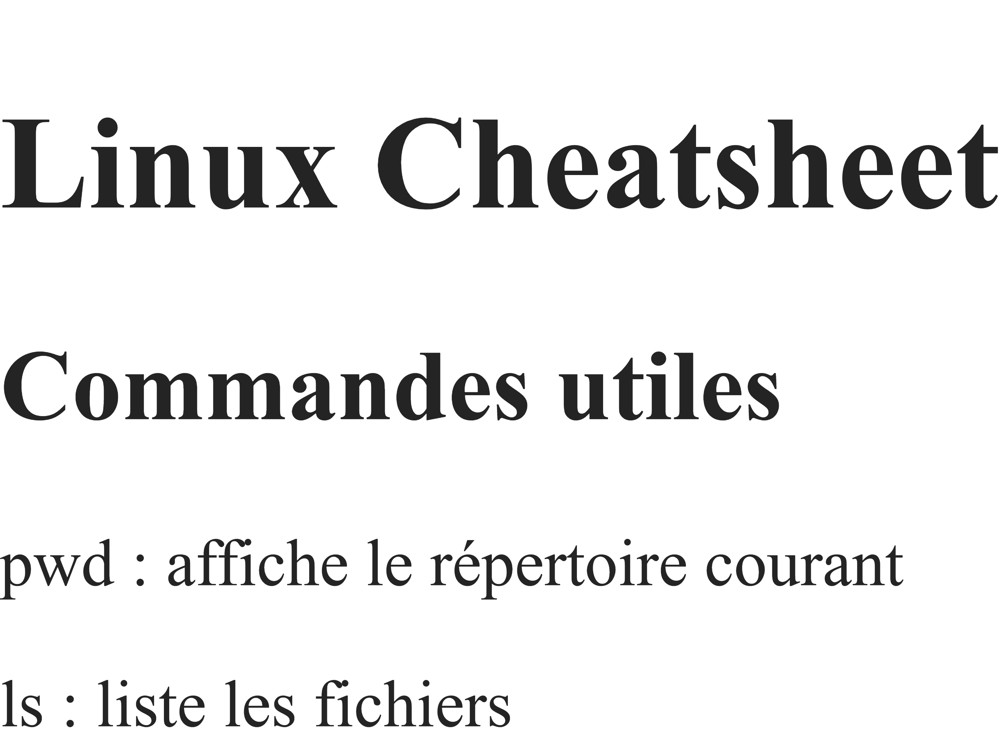
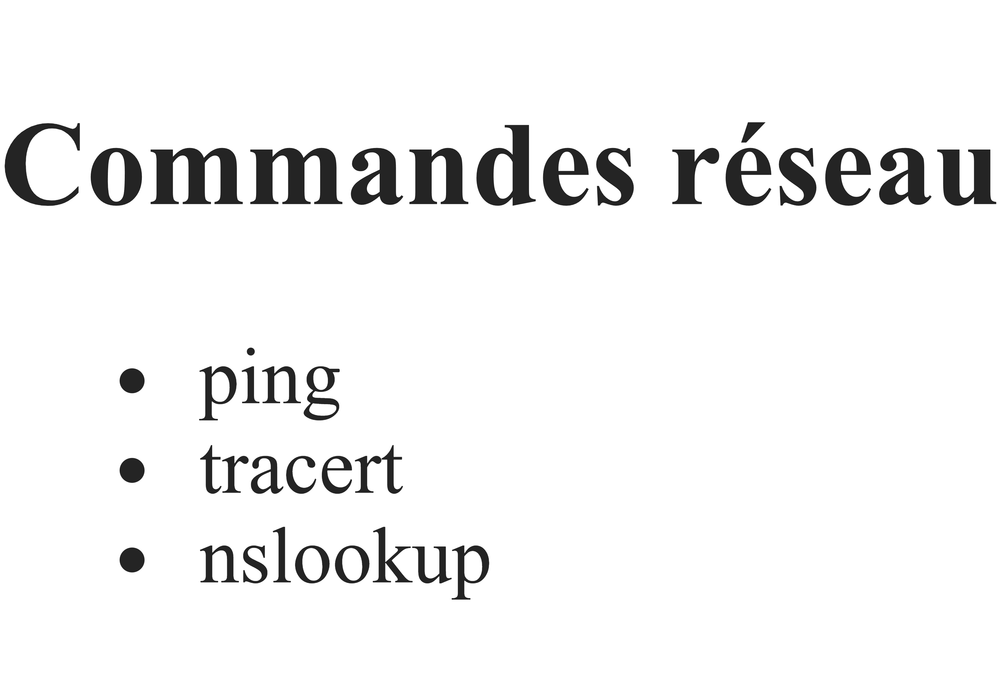

# linux-cheatsheet
tutorial
git clone https://github.com/jluc69b/linux-cheatsheet.git

• mkdir : Crée un nouveau dossier.
• touch : Crée un fichier vide ou met à jour sa date de modification.
• cp : Copie des fichiers ou des dossiers.
• mv : Déplace ou renomme des fichiers.
• rm : Supprime des fichiers ou des dossiers (avec -r pour un dossier)
création d'une branche

• cat : Affiche le contenu complet d'un fichier texte.
• grep : Recherche une chaîne de caractères ou un motif dans des fichiers.
• find : Cherche des fichiers et des dossiers dans l'arborescence.